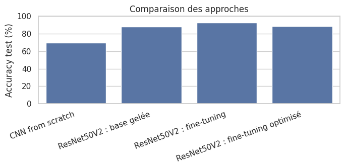
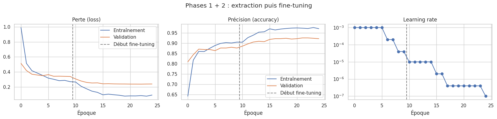
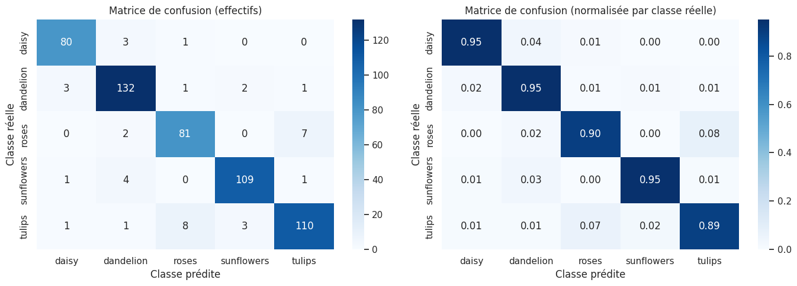
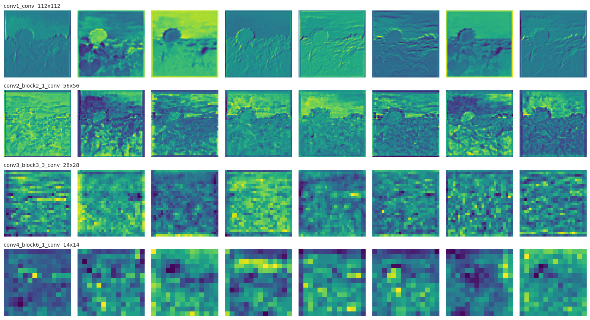

# 🌸 Fine-tuning ResNet50V2 – Classification d'images (5 classes)

Transfer learning d'un **ResNet50V2 pré-entraîné sur ImageNet**, adapté par fine-tuning à la classification de fleurs (`tf_flowers`, 3 670 images), avec une **application Streamlit interactive** pour explorer l'entraînement et faire de l'inférence.



## 🎯 Résultats (jeu de test, 551 images)

| Modèle | Paramètres entraînables | Accuracy test |
|---|---|---|
| CNN entraîné from scratch (référence) | 12,9 M | 69,9 % |
| ResNet50V2 – base gelée (feature extraction) | 10 k | 88,0 % |
| **ResNet50V2 – fine-tuning** | 14,4 M | **92,9 %** |

➡️ Le transfer learning apporte **+23 points** par rapport au CNN from scratch.

## 🧠 Démarche

1. **Données** : split stratifié 70 / 15 / 15 (train / validation / test), test jamais utilisé pour les décisions.
2. **Data augmentation** : flips, rotations, zoom, contraste.
3. **Phase 1 – feature extraction** : base ResNet50V2 gelée, entraînement de la tête (LR = 1e-3).
4. **Phase 2 – fine-tuning** : dégel des dernières couches, LR = 1e-5 pour éviter l'oubli catastrophique.
5. **Régularisation** : dropout, L2, early stopping, `ReduceLROnPlateau`.
6. **Optimisation des hyperparamètres** : Grid Search, Random Search et validation croisée (LR, nombre de couches dégelées, dropout, L2, batch size).
7. **Analyse** : matrice de confusion, rapport par classe, analyse des erreurs, visualisation des filtres et feature maps.

| Courbes du fine-tuning | Matrice de confusion |
|---|---|
|  |  |



## 🗂️ Structure

```
├── notebooks/Projet_FineTuning.ipynb   # entraînement complet (Google Colab, GPU)
└── app/                                # application Streamlit
    ├── app.py                          # 12 pages : étapes du notebook + inférence
    ├── extract_data.py                 # extrait courbes/métriques du notebook
    ├── data/results.json               # résultats d'entraînement
    ├── assets/                         # figures
    └── models/                         # y placer le modèle .keras (non versionné)
```

## 🚀 Lancer l'application

```bash
cd app
pip install -r requirements.txt
streamlit run app.py
```

Pour l'inférence en direct (upload d'image / caméra), placer `flowers_resnet50v2_finetuned.keras` (exporté depuis Colab) dans `app/models/`. Sans le modèle, toutes les pages d'analyse restent disponibles.

## 🛠️ Stack

Python · TensorFlow / Keras · ResNet50V2 · scikit-learn · Streamlit · Plotly · Google Colab (GPU)

## 👩‍💻 Auteure

**Eya Lakhal** – Étudiante en Informatique, ENIT
[LinkedIn](https://linkedin.com/in/eya-lakhal-058277373) · [Portfolio](https://eya-lakhal.github.io)
